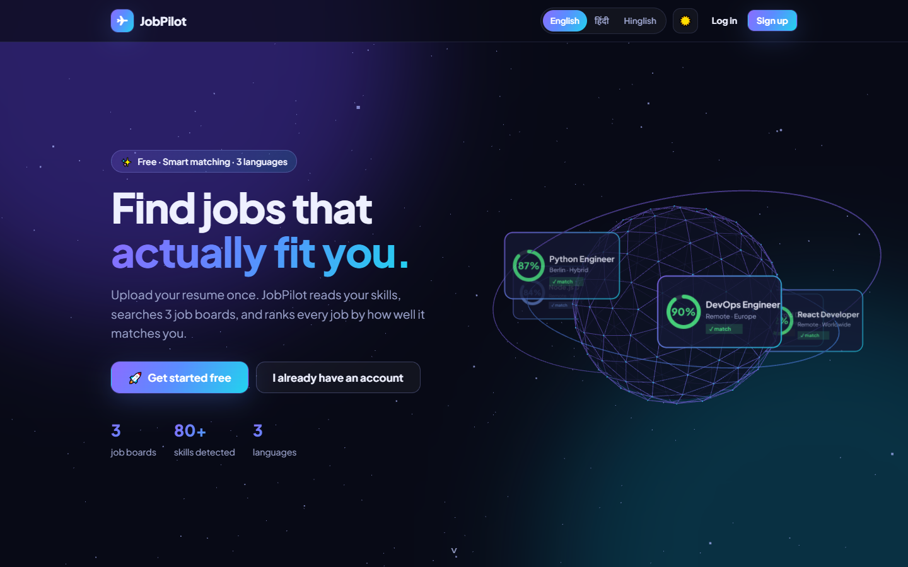
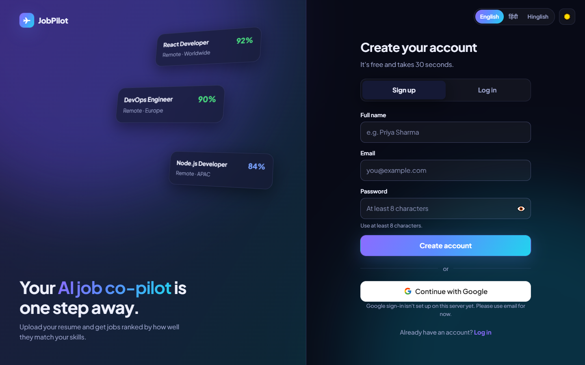
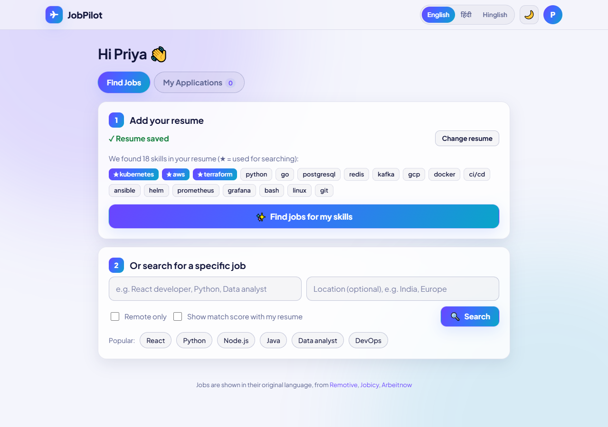
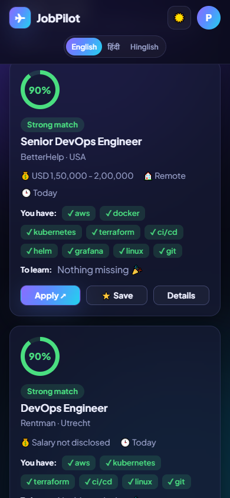

# JobPilot

**Upload your resume, get jobs ranked by how well they fit you.** JobPilot reads your skills, searches three job boards at once, and gives every job a match score with the skills you have and the ones you're missing.

It comes in two forms that share the same engine:

- **Web app**: 3D landing page, sign up / log in (email or Google), resume upload, ranked job search, and an application tracker, in **English, हिंदी, and Hinglish**, with dark and light themes. Works on phones and desktops.
- **MCP server**: plugs the same tools into AI assistants like Claude, so you can say *"find remote React jobs that fit my resume and save the best one."*



| Sign up | Find jobs | Mobile results |
|---|---|---|
|  |  |  |

## Features

- 📄 **Resume upload**: PDF, Word (.docx), or TXT, with drag and drop
- 🧠 **Skill detection**: 80+ technologies and their aliases (`nodejs` → `node.js`, `k8s` → `kubernetes`)
- ✨ **Jobs for my skills**: one click searches your top 3 job-defining skills, no typing needed
- 🎯 **Match score**: skill overlap plus text similarity, with core skills from the job title weighted 2x
- 🌍 **3 job boards**: Remotive, Jobicy, and Arbeitnow searched in parallel and deduplicated
- 📊 **Application tracker**: saved → applied → interview → offer / rejected, with response-rate stats
- 🔐 **Accounts**: email + password or "Continue with Google"; each user's resume and tracker are private
- 🗣️ **3 languages** and 🌗 **dark / light theme**, remembered per browser
- 📱 **Mobile responsive**: tested at 390px wide with no horizontal scrolling

## Quick start

```bash
npm install
cp .env.example .env    # optional: add Google credentials here
npm run web             # open http://localhost:3000
```

Want a resume to try it with? Upload [samples/Arjun_Mehta_DevOps_Resume.pdf](samples/Arjun_Mehta_DevOps_Resume.pdf) (a fictional DevOps engineer).

## How it works

```
Browser ──► web.ts (Node http) ──┬──► auth.ts     users, scrypt passwords, sessions
                                 ├──► google.ts   OAuth 2.0 code flow
                                 ├──► resume.ts   PDF (unpdf) / DOCX (mammoth) → text
                                 ├──► jobs.ts ──► sources.ts  Remotive · Jobicy · Arbeitnow
                                 ├──► matcher.ts  skills (80%) + text similarity (20%)
                                 └──► store.ts    per-user resume + applications (JSON)

AI assistant ──(MCP over stdio)──► index.ts ──► same jobs / matcher / store modules
```

**Job search** ([src/sources.ts](src/sources.ts), [src/jobs.ts](src/jobs.ts))
- Each job board has an adapter that maps its API into a shared `Job` type and cleans HTML (including double-encoded entities).
- Sources are queried in parallel with `Promise.allSettled`, so one board being down still returns the others' results. Responses are cached for 5 minutes.
- Results are deduplicated, filtered by location and remote preference, and ranked by relevance: a keyword in the title scores 5, in tags 3, in the description 1.

**Resume matching** ([src/matcher.ts](src/matcher.ts))
- **Skill overlap (80%)**: regex boundaries handle `C++`, `C#`, and `Next.js`, and avoid false hits on English words ("go", "rest") and substrings ("reactive").
- **Text similarity (20%)**: cosine similarity of word-frequency vectors, catching overlap the dictionary misses.
- **Confidence adjustment**: a job that names only one skill can't produce an inflated 100% score.
- **Top skills**: skills are counted in the resume, and supporting skills nearly everyone lists (Git, HTML, CSS, SQL) rank below job-defining ones (Python, React, Kubernetes).

**Accounts and security** ([src/auth.ts](src/auth.ts), [src/web.ts](src/web.ts))
- Passwords are hashed with **scrypt** (random salt) and compared in constant time. Unknown emails take the same time as wrong passwords.
- Sessions are random 256-bit tokens in an `HttpOnly`, `SameSite=Lax` cookie (`Secure` in production). Only a SHA-256 hash of each token is stored.
- Google sign-in uses the authorization code flow with a `state` cookie against forged callbacks, and accepts only verified emails. A Google login with an existing email links to that account.
- Login and sign-up are rate-limited per IP. Every user's data lives in its own folder, and user IDs are validated so a path can't escape the data directory.
- Static files are served only from `public/assets`, so path traversal like `/assets/../../.env` returns 404.

**Frontend** ([public/](public/)): plain HTML, CSS, and JavaScript with no build step. The landing page's 3D hero uses **Three.js** (a wireframe globe with job cards orbiting it, a starfield, and pointer parallax), with CSS 3D tilt cards and scroll reveals. It pauses when off-screen and respects `prefers-reduced-motion`.

## Set up "Continue with Google"

1. Open [Google Cloud Console → Credentials](https://console.cloud.google.com/apis/credentials) and create a project.
2. Configure the **OAuth consent screen** (External, app name "JobPilot", your email).
3. **Create credentials → OAuth client ID → Web application.**
4. Under **Authorized redirect URIs**, add `http://localhost:3000/auth/google/callback` (and your deployed URL + `/auth/google/callback` later).
5. Put the client ID and secret in `.env`:
   ```
   GOOGLE_CLIENT_ID=xxxx.apps.googleusercontent.com
   GOOGLE_CLIENT_SECRET=xxxx
   ```
6. Restart `npm run web`. The console shows `Google sign-in: enabled`.

Until this is set up, the Google button shows a friendly "not set up yet" note and email sign-up works normally.

## Deploy (Render, free)

1. Push this repo to GitHub.
2. On [render.com](https://render.com): **New → Blueprint**, then pick the repo. [render.yaml](render.yaml) configures the build and start commands.
3. Set `PUBLIC_URL` to your Render URL (e.g. `https://jobpilot.onrender.com`), plus the Google credentials if you use them. Add `<PUBLIC_URL>/auth/google/callback` to Google's redirect URIs.

> **Note:** accounts are stored as JSON files. Render's free plan has no persistent disk, so accounts reset when the service restarts. That's fine for a demo. For real users, attach a persistent disk (set `JOBPILOT_DATA_DIR` to it) or move storage to a database. See the roadmap.

## Use it with an AI assistant (MCP)

| Tool | What it does |
|---|---|
| `search_jobs` | Searches all three job boards, deduped and ranked by relevance |
| `rank_jobs` | Scores results against your resume. With no query, it searches by your resume's top skills |
| `get_job_details` | Full description of a job |
| `match_resume` | Resume-to-job fit (0-100) with matched, missing, and key skills |
| `save_resume` / `get_resume` | Saves your resume as text or from a PDF/DOCX/TXT file path |
| `save_application` / `update_application` / `delete_application` / `list_applications` | Application tracker with stats |

Prompts: `cover_letter` and `interview_prep` build tailored requests from a job and your resume.

```bash
npm run build
claude mcp add jobpilot -- node /absolute/path/to/jobpilot-mcp/build/index.js
```

For Claude Desktop, add this to `claude_desktop_config.json` (Windows: `%APPDATA%\Claude\claude_desktop_config.json`):

```json
{ "mcpServers": { "jobpilot": { "command": "node", "args": ["/absolute/path/to/jobpilot-mcp/build/index.js"] } } }
```

The MCP server is single-user and stores data in `~/.jobpilot/`.

## Testing

| Command | What it does |
|---|---|
| `npm test` | 16 offline unit tests: matcher, top skills, PDF/TXT parsing, ranking, dedupe, source failures, per-user storage isolation, and auth (hashing, sign-up validation, login, sessions, Google account linking) |
| `npm run e2e` | Spawns the MCP server and drives every tool and prompt against the live job APIs |
| `npm run inspect` | Opens the MCP Inspector to call tools by hand |

## Tech stack

TypeScript · Node.js (built-in `http`, `crypto`, `node:test`) · Model Context Protocol SDK · Zod · unpdf · mammoth · Three.js · vanilla HTML/CSS/JS

## Roadmap

- [ ] Database storage (Supabase / Postgres) for persistent multi-user hosting
- [ ] Semantic matching with embeddings
- [ ] More job sources, including India-focused boards
- [ ] Email verification and password reset
- [ ] Publish the MCP server to npm (`npx jobpilot-mcp`)

## Credits

Job listings come from [Remotive](https://remotive.com), [Jobicy](https://jobicy.com), and [Arbeitnow](https://www.arbeitnow.com). Each listing links back to its original posting.

## License

MIT
